# Cloud Observability Lab

API de Helpdesk (chamados) em FastAPI, rodando em Docker numa instância EC2 da AWS, monitorada com Prometheus e Grafana. O projeto cobre o ciclo completo de operação: subir o serviço, medir, criar painéis, receber um alerta, diagnosticar um incidente e documentar a resposta em um runbook.

**Objetivo:** praticar o dia a dia de Cloud Support / NOC: monitorar um serviço, ser avisado quando ele cai, achar a causa e restaurar, controlando o custo.

## Arquitetura

```
 Operador (meu IP)
      │  SSH 22 · API 8000 · Prometheus 9090 · Grafana 3000
      ▼
┌──────────────── AWS · us-east-1 · EC2 t3.micro ─────────────────┐
│  Rede Docker "observabilidade"                                   │
│                                                                  │
│  gerador-carga ──► helpdesk-container (FastAPI :8000) ──► postgres (volume pgdata)
│                          ▲                                       │
│                          │ scrape /metrics a cada 15 s           │
│                     prometheus (:9090) ──► grafana (:3000)       │
│                                              └─ alerta "API Helpdesk fora do ar"
└──────────────────────────────────────────────────────────────────┘
```

> O diagrama no padrão AWS (`.drawio`) será adicionado em `docs/img/`.

| Componente | Função |
|---|---|
| `helpdesk-container` | API FastAPI de chamados, expõe `/metrics` |
| `postgres` | Banco PostgreSQL 16 com volume persistente `pgdata`, sem porta publicada |
| `prometheus` | Coleta as métricas da API a cada 15 s |
| `grafana` | Dashboard com 3 painéis e regra de alerta |
| `gerador-carga` | Gera tráfego contínuo (≈ 0,65 req/s) para os gráficos ficarem vivos |

## Stack

FastAPI · SQLModel · PostgreSQL 16 · Docker · Prometheus · Grafana · AWS EC2 · Security Groups · AWS Budgets

## Estrutura do repositório

```
.
├── main.py                       # API de chamados (FastAPI + SQLModel)
├── gerador_carga.py              # Gerador de tráfego contínuo
├── Dockerfile                    # Imagem da API
├── requirements.txt
├── prometheus.yml                # Alvo de coleta (scrape) do Prometheus
├── grafana/
│   ├── dashboard-helpdesk.json   # Dashboard exportado
│   └── alerta-api-fora-do-ar.yaml# Regra de alerta exportada
└── docs/
    ├── runbook-api-fora-do-ar.md # Resposta ao incidente
    ├── analise-de-custos.md      # Custos, controles e alternativa serverless
    └── img/                      # Prints do projeto
```

## API

| Método | Rota | O que faz |
|---|---|---|
| GET | `/` | Health simples (`Helpdesk API no ar`) |
| GET | `/chamados` | Lista chamados |
| POST | `/chamados` | Cria chamado |
| PUT | `/chamados/{id}?novo_status=...` | Atualiza o status |
| GET | `/metrics` | Métricas no formato Prometheus |

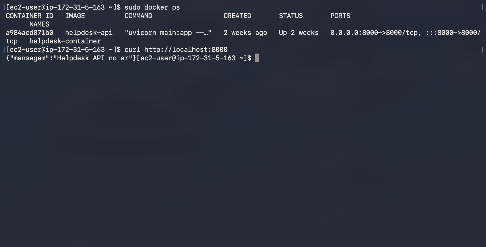

## Como rodar

Pré-requisitos: uma EC2 (Amazon Linux 2023) com Docker instalado e o Security Group liberando 22, 8000, 9090 e 3000 **somente para o seu IP**.

Na EC2, com os arquivos do repositório no diretório atual:

```bash
# 1. Rede compartilhada: os containers se enxergam pelo nome
sudo docker network create observabilidade

# 2. Banco com volume persistente (troque <SENHA>)
sudo docker run -d --name postgres --network observabilidade \
  --restart unless-stopped \
  -e POSTGRES_USER=helpdesk -e POSTGRES_PASSWORD=<SENHA> -e POSTGRES_DB=helpdesk \
  -v pgdata:/var/lib/postgresql/data \
  postgres:16

# 3. API
sudo docker build -t helpdesk-api .
sudo docker run -d --name helpdesk-container --network observabilidade \
  --restart unless-stopped -p 8000:8000 \
  -e DATABASE_URL=postgresql+psycopg2://helpdesk:<SENHA>@postgres:5432/helpdesk \
  helpdesk-api

# 4. Prometheus
sudo docker run -d --name prometheus --network observabilidade \
  --restart unless-stopped -p 9090:9090 \
  -v $(pwd)/prometheus.yml:/etc/prometheus/prometheus.yml \
  prom/prometheus

# 5. Grafana
sudo docker run -d --name grafana --network observabilidade \
  --restart unless-stopped -p 3000:3000 \
  grafana/grafana

# 6. Gerador de carga
sudo docker run -d --name gerador-carga --network observabilidade \
  --restart unless-stopped \
  -e PYTHONUNBUFFERED=1 \
  -v $(pwd)/gerador_carga.py:/app/gerador_carga.py \
  python:3.12-slim python /app/gerador_carga.py
```

Depois, no Grafana (`http://<IP-DA-EC2>:3000`): adicionar o data source Prometheus em `http://prometheus:9090` e importar `grafana/dashboard-helpdesk.json`.

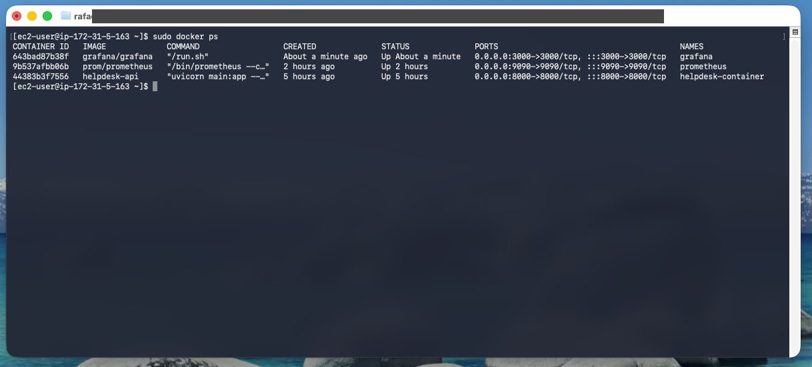

## Observabilidade

O Prometheus coleta `/metrics` da API a cada 15 s. O alvo aparece como **UP** em Status → Target health.

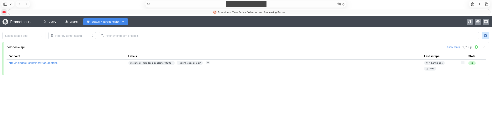

Dashboard com 3 painéis:

| Painel | Consulta (PromQL) |
|---|---|
| Requisições por segundo | `sum(rate(http_requests_total[1m]))` |
| Erros 4xx/5xx por segundo | `sum(rate(http_requests_total{status=~"4xx\|5xx"}[1m]))` |
| Latência p95 (segundos) | `histogram_quantile(0.95, sum(rate(http_request_duration_highr_seconds_bucket[1m])) by (le))` |

O gerador de carga mistura listar (50%), criar (25%), atualizar (15%), acessar a home (5%) e chamar uma rota inexistente (5%, gera os erros 4xx).

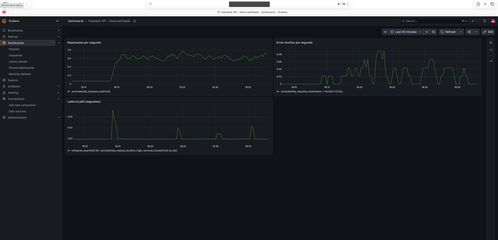
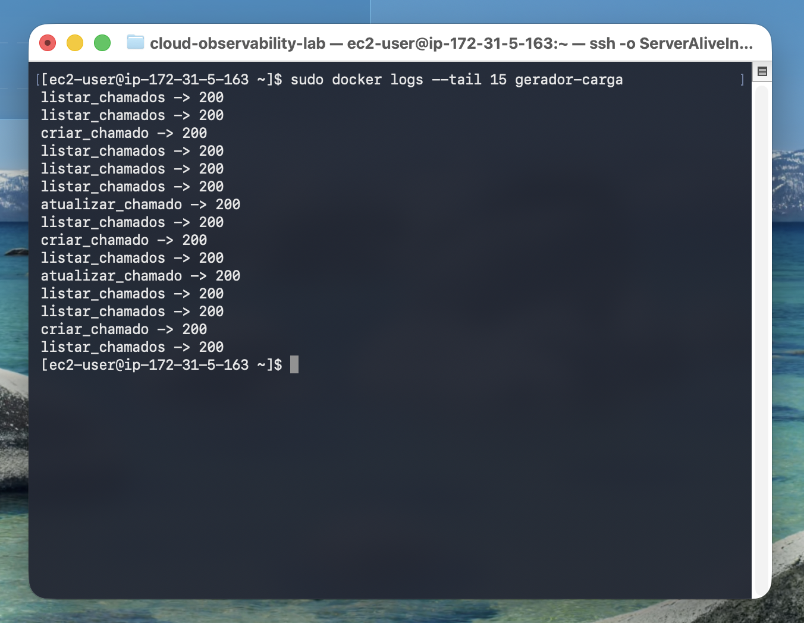

## Incidente simulado

**Alerta:** `API Helpdesk fora do ar`, regra `up{job="helpdesk-api"} < 1`, avaliada a cada 1 min, com pending period de 1 min.

1. `docker stop helpdesk-container` simula a queda.
2. O Prometheus perde o alvo e `up` vai a 0.
3. O alerta passa de **Normal** para **Pending** e depois para **Firing**, cerca de 3 minutos após a queda.
4. Diagnóstico com `docker ps -a` (status `Exited (0)`, parada manual) e `docker logs`.
5. Resolução com `docker start helpdesk-container`. O alerta volta a **Normal**.

| Normal | Firing |
|---|---|
| 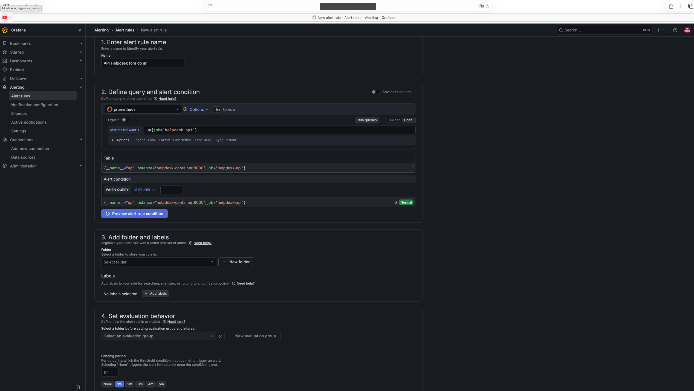 | 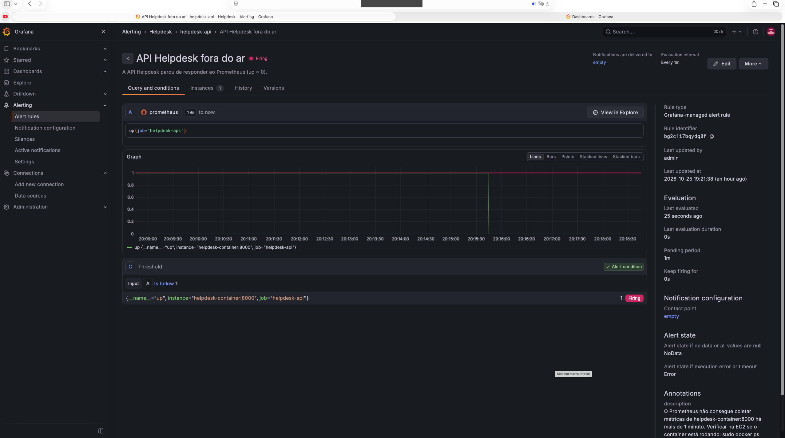 |

O dashboard registra a queda e a recuperação:

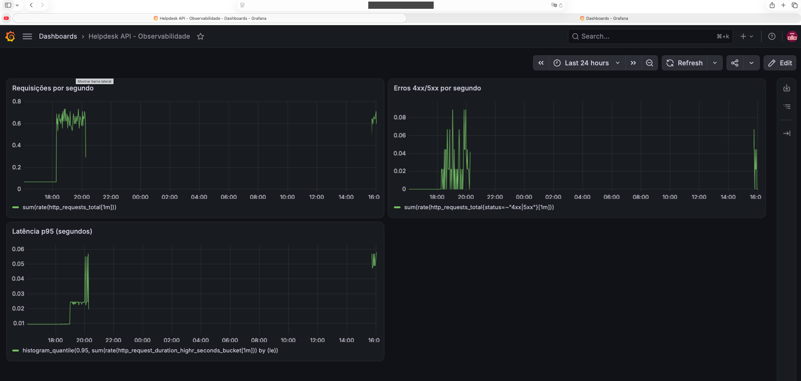

Procedimento completo, causa raiz e prevenção: [`docs/runbook-api-fora-do-ar.md`](docs/runbook-api-fora-do-ar.md).

## Persistência

A API começou com SQLite e migrou para PostgreSQL em container, com volume `pgdata`. Teste de persistência: contei os chamados (10), destruí e recriei o container da API, e a contagem continuou 10.

| Antes | Depois de recriar a API |
|---|---|
| 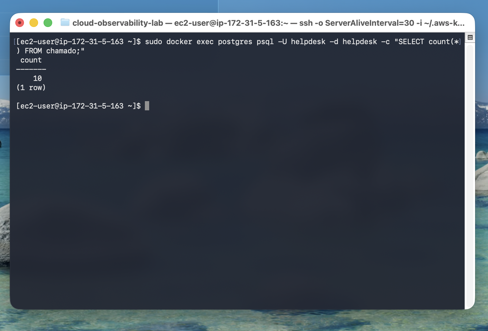 | 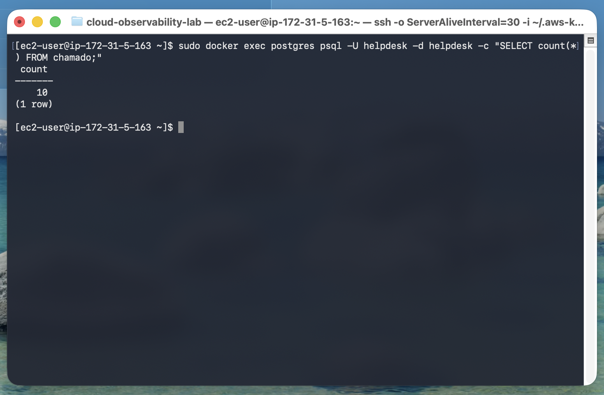 |

## Custos

EC2 `t3.micro` ligada 24/7 custa ≈ US$ 11,88/mês (instância US$ 7,59, IPv4 público US$ 3,65, EBS US$ 0,64). Parada, cai para ≈ US$ 0,64/mês. Controles aplicados:

- parar a instância ao fim de cada sessão;
- sem Elastic IP (o IP público some ao parar);
- AWS Budget `lab-guardrail` em US$ 12, com alertas em 85% e 100% do custo real e 100% do previsto (ele avisa, não bloqueia);
- Security Group restrito ao meu IP e banco sem porta publicada.

A análise inclui uma alternativa serverless (API Gateway + Lambda + DynamoDB, ≈ US$ 2,41 a US$ 3,32/mês no mesmo tráfego) e o ponto de equilíbrio, em torno de 6 milhões de requisições por mês. Detalhes e fontes em [`docs/analise-de-custos.md`](docs/analise-de-custos.md).

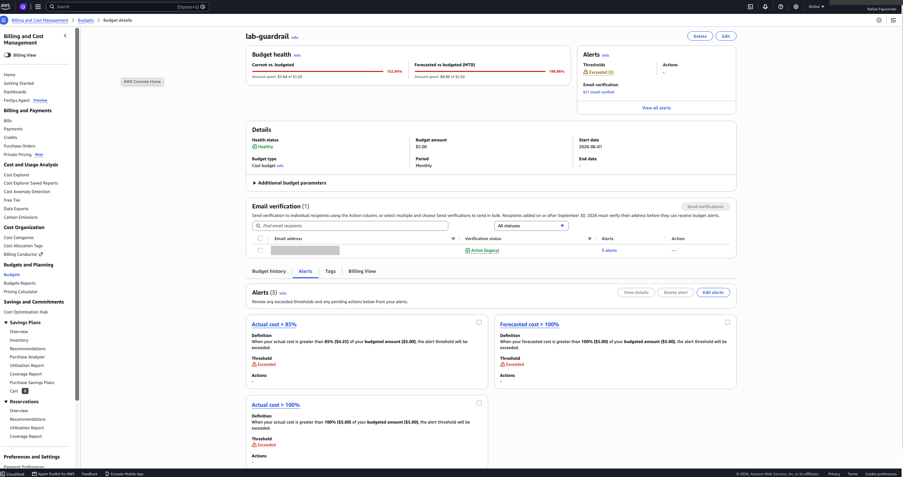

## Decisões técnicas

| Decisão | Motivo |
|---|---|
| Rede Docker própria (`observabilidade`) | Os containers se acham pelo nome (`postgres`, `helpdesk-container`), sem depender de IP |
| PostgreSQL sem porta publicada | Só a API, dentro da rede Docker, acessa o banco |
| Volume `pgdata` | Os dados sobrevivem à recriação de containers |
| `postgresql+psycopg2://` na `DATABASE_URL` | O prefixo `postgresql://` escolhia o driver psycopg v3, que não está instalado |
| `--restart unless-stopped` | Os serviços voltam sozinhos após queda ou reinício da instância |
| Alerta com condição `IS BELOW 1` | A condição padrão (`IS ABOVE 0`) disparava com a API saudável |
| Sem Elastic IP | Evita pagar IPv4 com a instância parada, ao custo de atualizar o Security Group a cada reinício |
| Budget ajustado de US$ 5 para US$ 12 | O limite inicial estava abaixo do custo real e o alerta nascia disparado |

## Limitações e próximos passos

- `GET /chamados` não tem paginação.
- Chamado inexistente retorna `200` com mensagem de erro, em vez de `404`.
- O contact point do alerta está vazio (`empty`). Em produção seria Slack ou e-mail.
- Faltam alertas de taxa de erro 5xx e de latência p95.
- Provisionar a infraestrutura (EC2 e Security Group) com Terraform.
- Reiniciar a instância muda o IP público, e o Security Group precisa ser atualizado.
- Diagrama de arquitetura no padrão AWS.
